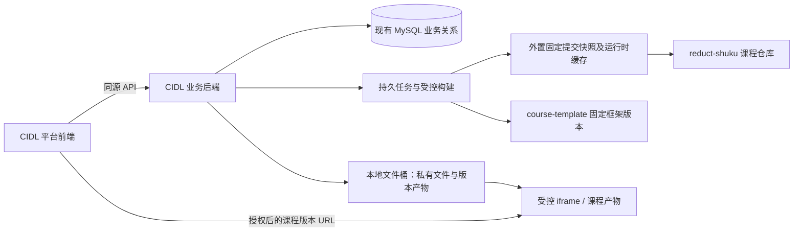

# CIDL 前后端与课程存储解耦迁移方案

> 状态：迁移分析与任务建议，待评审、未实施。日期：2026-10-29。
>
> 源码核对基线：`ReductTech/intuitive-deep-learning` 的 `develop`，提交 `35303afcbf06edd4a8db7ecee4d1c548f72ab195`。当前运行版最近部署记录为 `8c72454`；源码有新提交不等于运行包已更新。本文件只交付分析、清单与验收要求，不创建 CIDL 远程仓库、不拆分真实课程、不切换运行服务。
>
> 本方案独立于原“术库后端迁移”文档，按目前已有的前后端、GitHub/ZIP 导入及服务器部署重新盘点。目标 CIDL 指新的术库业务仓库，不默认等同于代码中已有的 `cloud-intuitive-deep-learning` 计算服务仓库。

## 1. 结论：迁移哪些内容

CIDL（Cloud-IDL）应承接术库的业务前端、业务后端、通用编辑器、播放器框架、课程构建工具、创作协议、测试和部署配置。真实课程源码与素材放在 `reduct-shuku` 账号管理的课程仓库中，通过固定提交、数据库中的课程关系和受控文件服务加载。

第一版建议保留现有 Python 包名 `shuku_backend`、API 前缀 `/api/shuku/` 和业务表名，减少拆仓引入的兼容风险。仓库名改为 CIDL 不要求同时重命名所有接口和数据库表。

必须同时完成两件事：

1. **代码归属拆分**：CIDL 的 Git 中不再保存真实课程及其图片、视频等内容；通用框架有独立位置。
2. **运行依赖拆分**：CIDL 的生产构建不再导入真实课程 React 组件，课程发布不再要求重新构建整个平台。

当前代码不能通过“复制 `src`、`backend` 后直接删除 `modules/`”完成迁移。`modules/shared/` 是通用框架；课程目录、路由、编辑器和构建工具仍依赖课程源码。只把课程移到 Git 外置目录、随后由 Vite 全部打进平台包，只完成了文件归属拆分。

### 1.1 三类数据的归属

| 内容 | 权威来源或持久存储 | CIDL 中的职责 |
| --- | --- | --- |
| 业务代码、编辑器和通用播放器 | CIDL Git 仓库 | 维护、构建、部署 |
| 正式课程源码、图片、讲稿、版本化清单 | `reduct-shuku` 下对应课程仓库 | 通过 GitHub App 读取固定提交、核对摘要、记录发布关系 |
| 旧版聚合课程库 | 现有 `reduct-shuku/intuitive-deep-learning` 固定快照 | 作为历史来源兼容，不要求本次立即全部拆成独立仓库 |
| 公共创作模板和依赖框架 | `reduct-shuku/course-template` 固定版本 | 维护锁定关系与兼容适配，继续支持本地 Agent |
| 用户、归属、权限、审核、贡献、收藏、学习进度、任务、审计 | 当前术库 MySQL 业务表 | 继续处理事务与权限，不因拆仓改变数据库引擎 |
| 上传原件、私有草稿文件、已保存修订、课程产物、音频与下载缓存 | 服务器本地文件桶及外置缓存 | 校验、鉴权、引用管理、备份和恢复；文件内容不放进数据库 |

“课程保存到 reduct-shuku”指课程的版本化来源和发布同步目标。私有草稿可能尚未完成 GitHub 同步，本地文件桶及数据库中的修订仍须保留。在线学习从已经核验的快照和产物读取，不能每次打开都依赖 GitHub 网络。

## 2. 当前代码中已经具备什么，还耦合在哪里

### 2.1 已经可以复用的能力

- [业务前端 `src/shuku/`](../src/shuku/) 已包含身份、课程、审核、共创、治理、反馈、收藏、续学、导入、预览和讲解入口。
- [创作前端 `src/creator/`](../src/creator/) 已有工作区、大纲、页面属性、讲稿、图片存储和文字编辑等能力，不能只迁移 `src/shuku/`。
- [业务后端 `shuku_backend/`](../backend/src/shuku_backend/) 已经独立成 Python 包，有 MySQL、文件桶、持久任务、GitHub 接口和权限校验。
- [组织课程收录](../backend/src/shuku_backend/organization_catalog.py) 已扫描配置的 GitHub 组织、产生待收录项并由管理员确认。
- [标准课程导入](../backend/src/shuku_backend/course_imports.py) 已支持 GitHub/ZIP 来源、固定依赖、私有仓库初始化和可编辑修订。
- [学习页面](../src/shuku/LearningPage.tsx) 已通过修订 ID 请求播放器，再在受控 iframe 中展示课程。
- [本地 Agent](../backend/src/shuku_backend/local_agent.py) 已下载指定快照、使用固定创作框架，能够继续沿用。

### 2.2 尚未完成的解耦

| 当前位置 | 已确认的耦合 | CIDL 必须采取的处理 |
| --- | --- | --- |
| [src/app/modules.tsx](../src/app/modules.tsx) | `import.meta.glob` 立即导入全部课程大纲及入口 TSX，生成 `activeModules` | 将课程数据模型和本地组件注册分开；生产端改用 API 返回的课程元数据与产物 URL |
| [src/app/HomePage.tsx](../src/app/HomePage.tsx) | 虽读取 `/public/courses`，库课程仍要匹配 `activeModules` 才能显示 | 直接展示已授权 API 目录，不以组件是否被编译进平台判断课程存在与否 |
| [src/app/routes.tsx](../src/app/routes.tsx)、[BuiltinLearning.tsx](../src/shuku/BuiltinLearning.tsx)、[CourseDetails.tsx](../src/shuku/CourseDetails.tsx) | 原生课程路由和详情使用前端课程组件 | 统一通过课程/修订加载；旧路由经别名映射进入对应课程版本 |
| [CreatorWorkspace.tsx](../src/creator/CreatorWorkspace.tsx)、[ManagedEditor.tsx](../src/shuku/ManagedEditor.tsx) | 从本地 `activeModules` 选择起始课程或模板 | 从后端读取项目、模板和固定来源；支持无现成课程时的空白创作 |
| [modules/shared/](../modules/shared/) | 包含公共组件、演示框架、交互状态、数学公式支持及遥测，位于课程目录下 | 提取为 CIDL 的通用运行时，并为旧课程导入路径提供兼容解析 |
| [vite.config.ts](../vite.config.ts) | 导入 Creator-Guide 内插件、课程库 Vite 插件，指定 Visual-Feature-Learning 的三个 HTML 构建入口；`publicDir` 指向课程素材 | 平台构建只保留平台入口和平台资源；课程构建入口交给独立课程任务 |
| [index.html](../index.html) | 直接加载 `/modules/shared/telemetry.js` | 移入平台公共资源路径，更新加载地址及对应部署规则 |
| [library_catalog.py](../backend/src/shuku_backend/library_catalog.py)、[workflow.py](../backend/src/shuku_backend/workflow.py)、[settings.py](../backend/src/shuku_backend/settings.py) | 扫描固定课程库的 `modules/*/outlines.json`；校验聚合仓库名称；按缓存父目录寻找历史快照 | 保留旧来源适配，增加多仓库来源解析和外置快照根目录，不把 CIDL 根目录当课程库 |
| [build-shuku-preview.mjs](../scripts/build-shuku-preview.mjs)、[shuku-source-plugin.mjs](../scripts/shuku-source-plugin.mjs) | 编译依赖平台源码、课程快照、`modules/shared` 和固定模板 | 分离平台根目录、课程根目录、运行时根目录；保留依赖白名单与路径边界 |
| [course-library-vite.ts](../scripts/course-library-vite.ts) | 可从外置目录读取课程，但仍在平台构建时打包课程组件 | 仅作为过渡/本地预览适配，不作为最终生产目录方案 |

另一个重要边界：组织扫描当前处理带清单的静态 HTML 课程快照；标准 React/TSX 课程的 GitHub/ZIP 导入属于私有创作流程。这两条链路尚未统一，不能假定“仓库可扫描”就等于“源码课程已完成审核、构建、正式发布”。

## 3. 应迁入 CIDL 的文件夹和主要代码

### 3.1 前端与通用运行时

| 现有目录/文件 | 迁移建议 | 主要处理 |
| --- | --- | --- |
| [src/shuku/](../src/shuku/) | 整体迁移 | 保留业务流程；替换本地课程组件依赖 |
| [src/creator/](../src/creator/) | 整体迁移 | 保留大纲、讲稿、编辑、草稿与预览；从后端载入课程 |
| [src/app/](../src/app/)、[src/App.tsx](../src/App.tsx)、[src/main.tsx](../src/main.tsx)、[src/types/](../src/types/)、[src/vite-env.d.ts](../src/vite-env.d.ts) | 迁移并改造 | 路由、布局、样式和类型保留；删除生产端的真实课程静态注册 |
| [src/preview/](../src/preview/) | 保留协议，拆分入口 | 本地课程预览与生产平台构建分开，不因为平台拆仓丢失本地 Agent 预览能力 |
| [modules/shared/react/](../modules/shared/react/) | 提取为 `packages/course-runtime/react/` | 包括 UI、画布缩放、演示、学习交互、路由工具、样式；保留类型和导出约定 |
| [modules/shared/vendor/](../modules/shared/vendor/)、[mathlive-loader.js](../modules/shared/mathlive-loader.js)、[plot-utils.js](../modules/shared/plot-utils.js) | 盘点后迁入同一运行时包 | 公式、图表等必要依赖及许可证保留；大型库按需加载，课程专属资源外置 |
| [modules/shared/telemetry.js](../modules/shared/telemetry.js) | 提取为平台公共脚本 | 同时修改 HTML 引用与部署路径，采集端未启用时维持明确降级 |
| [modules/Creator-Guide/skillDocumentsPlugin.ts](../modules/Creator-Guide/skillDocumentsPlugin.ts) | 提取为 `scripts/creator-skill-documents.ts` | 这是构建工具，不能随 Creator-Guide 课程一起被删除 |
| [creator-skill/](../creator-skill/) | 作为平台创作规范迁移 | 与 `course-template/creator-skills` 明确固定版本及发布关系，避免向每个课程仓库复制一套规范 |
| [deprecated/Edit-Deck/](../deprecated/Edit-Deck/) | 先保留实际被引用的部分，再提取 | Vite 使用其 `server.ts`，设计图与本机文字编辑引用 `api.ts`、`types.ts` 等；不能因为名为 deprecated 就直接删除 |

`Creator-Guide` 的讲解课程本身属于课程内容，应留在课程仓库；构建插件、创作规范及公用组件属于平台能力。它们目前恰好位于同一课程目录，需要按用途拆分。

历史课程引用 `../../shared/react`、`modules/shared/react` 等逻辑路径时，构建器应将其解析到已核验的运行时。兼容逻辑路径不要求 CIDL Git 中继续保留真实课程的 `modules/`。

### 3.2 后端：建议第一版完整迁移 `backend/`

直接迁移 [backend/pyproject.toml](../backend/pyproject.toml)、[backend/src/shuku_backend/](../backend/src/shuku_backend/) 和相应测试，保留 Python 启动模块及 `shuku_` 表名。

| 业务范围 | 主要代码，均相对于 `backend/src/shuku_backend/` |
| --- | --- |
| 启动、配置、HTTP 与服务装配 | `__main__.py`、`application.py`、`settings.py`、`api.py`、`errors.py` |
| 身份、角色和管理授权 | `adapters/identity.py`、`adapters/jianlun.py`、`admin.py`、`services.py`、`github_identity.py`、`adapters/github_identity.py` |
| 关系存储、迁移和文件桶 | `database.py`、`schema.py`、`migrations.py`、`storage.py`、`files.py`、`database_transfer.py` |
| 不可变修订、源码编辑与草稿 | `workflow.py`、`source.py`、`drafts.py`、`presentations.py` |
| 首次审核、差异审核、共创、贡献 | `workflow.py`、`collaboration.py`、`review_inbox.py` |
| GitHub 仓库、同步、合并、发版及私有工作区 | `github_sync.py`、`adapters/github.py`、`hosted_workspaces.py`、`repository_names.py` |
| 聚合库兼容、组织扫描与标准包导入 | `library_catalog.py`、`organization_catalog.py`、`course_imports.py`、`course_package.py`、`github_course_source.py` |
| 本地 Agent 与下载客户端 | `local_agent.py`、`local_agent_client.py` |
| 播放、讲稿、进度、反馈与治理 | `player.py`、`narration.py`、`personal.py`、`feedback.py`、`governance.py` |
| 持久任务、超时和子进程回收 | `workers.py`、`build_process.py` |

[backend/src/idl_backend/](../backend/src/idl_backend/) 建议第一阶段也随包保留，减少漏依赖风险，但不因此启动所有计算服务或安装全部模型依赖。目前已确认：

- [adapters/idl.py](../backend/src/shuku_backend/adapters/idl.py) 导入 `idl_backend.contracts.client`。
- [narration.py](../backend/src/shuku_backend/narration.py) 的配置后备路径依赖 `idl_backend.config.repository_root`。
- [idl_backend/config.py](../backend/src/idl_backend/config.py) 会通过 `modules/` 和 `scripts/` 寻找仓库根目录；去掉 `modules/` 后需要显式设置 `IDL_REPOSITORY_ROOT` 或更换根目录识别方式。

后续可把必需契约和配置提取为小型公共包，再将模型训练等可选实现交给独立计算服务。当前服务器没有部署完整计算/Cloud 服务，迁入 CIDL 不代表原先返回 503 的计算、短信或真实 Web Agent 功能自动可用。

### 3.3 构建、协议、配置和测试

| 内容 | 处理 |
| --- | --- |
| [build-shuku-preview.mjs](../scripts/build-shuku-preview.mjs)、[shuku-source-plugin.mjs](../scripts/shuku-source-plugin.mjs)、[shuku-runtime-compat.mjs](../scripts/shuku-runtime-compat.mjs)、[inspect-course-package.mjs](../scripts/inspect-course-package.mjs) | 必须迁移，是保存修订和播放器构建的实际依赖；适配新的根目录和运行时位置 |
| [prepare-authoring-framework.mjs](../scripts/prepare-authoring-framework.mjs)、[local-authoring.lock.json](../local-authoring.lock.json) | 必须迁移，维持固定创作模板及历史依赖版本 |
| [course-library-fetch.mjs](../scripts/course-library-fetch.mjs)、[course-library.lock.json](../course-library.lock.json) | 保留为旧课程聚合库兼容入口，再增加多仓库快照定位 |
| [course-library-export.py](../scripts/course-library-export.py)、[export-course-scenes.mjs](../scripts/export-course-scenes.mjs)、[vite.course-scenes.config.ts](../scripts/vite.course-scenes.config.ts) | 盘点后保留必要的导出、实际页码清单生成与兼容流程；不再默认从 CIDL 中导出课程正文 |
| [shuku-local-agent.py](../scripts/shuku-local-agent.py)、[shuku-local.py](../scripts/shuku-local.py)、[shuku-local.ps1](../scripts/shuku-local.ps1)、[verify-course-import.py](../scripts/verify-course-import.py) | 保留客户端和操作验证入口，更新仓库/平台地址定位方式 |
| [package.json](../package.json)、[package-lock.json](../package-lock.json)、[tsconfig.json](../tsconfig.json)、[vite.config.ts](../vite.config.ts)、[index.html](../index.html) | 必须迁移并改造；重新生成锁文件时单独审查，避免同时升级依赖 |
| [backend/tests/shuku_backend/](../backend/tests/shuku_backend/)、相关 `scripts/check-shuku-*.mjs`、源码/运行时测试、`src/creator/*.test.mjs` | 迁移相关测试，用临时课程夹具替代对真实 `modules/` 的依赖 |
| [deploy/5173/](../deploy/5173/) | 作为本 Demo 主机的部署参考；维护 CIDL 自己的模板，替换代码根目录和启动环境 |

不能只选一两个 `check-shuku` 测试就宣称全部行为迁移完毕。应按登录、课程创作、审核、共创、发布、治理、学习和故障恢复分别选择必要的精确测试。

### 3.4 不进入 CIDL Git 的内容

- `modules/<真实课程>/`、`modules-legacy/` 及课程专属的 `assets/<课程UUID>/`。
- `datasets/` 中的运行数据、模型和训练产物；若需要课程计算，独立挂载或由计算服务管理。
- `.course-library/`、`.authoring-template/`、本地文件桶、构建缓存、运行日志、`dist/`、`node_modules/`、测试截图和报告。
- `.env`、`settings.json` 中的真实配置、数据库连接、GitHub 私钥、Token 加密密钥及其他凭据。
- `.git/`、`.worktrees/`、旧发布目录与无关历史实验文件。
- `web_agent/`、`work/`、`history/` 等先做引用盘点；尚未部署或仅实验的能力不作为维持当前服务的必需项。

平台图标、通用样式所需字体和必要的合法厂商资源仍可进入平台包；课程专属媒体与模型不随平台每次发布重复复制。

## 4. 建议的 CIDL 结构

以下是目标结构，不是当前已经存在或已经可以启动的目录。

```text
CIDL/
  src/
    app/                         # 平台布局、API 目录、动态路由
    shuku/                       # 术库业务页面、播放器宿主和接口客户端
    creator/                     # 编辑器、大纲、讲稿、页面属性
    preview/                     # 与本地课程运行环境分离的预览适配
    types/
    main.tsx
    App.tsx
  packages/
    course-runtime/              # 从 modules/shared 提取的通用框架
      react/
      vendor/
  public/                        # 平台自身的小型公共资源
  creator-skill/                 # 创作规范源及版本说明
  backend/
    pyproject.toml
    src/shuku_backend/
    src/idl_backend/              # 第一阶段兼容保留，后续按契约裁剪
    tests/
  scripts/                       # 构建、课程源解析、模板准备、验证
  deploy/                        # CIDL 自身的部署模板与运维文档
  docs/
  local-authoring.lock.json
  course-library.lock.json       # 过渡期兼容旧聚合库
  package.json
  package-lock.json
  tsconfig.json
  vite.config.ts
  index.html
```

课程包内部仍可采用 `modules/<课程>` 或现有 `courses/sources/modules/<课程>` 逻辑结构。要剔除的是 CIDL 仓库中的真实课程，不是强制一次性改写所有历史课程包内部路径。

## 5. 课程来源、目录和播放的目标链路



### 5.1 首页与旧链接

1. 首页根据后端返回的上架状态、标题、封面、分类、页数和版本生成卡片；不需要载入课程组件。
2. 原生库课程和独立仓库课程应有统一的公开展示模型，保留来源差异，不靠静态组件匹配决定是否展示。
3. `course_id`、`module_id`、仓库 ID、修订 ID、发布 ID、页面 ID 均保持稳定，不因拆仓重新生成。
4. 现有 `/learn?revision=...&mode=...` 链接继续可用。旧 `/study?module=...`、课程别名路径及必要的历史 HTML 入口要有映射，保留 `page`、`resume`、`mode` 参数。
5. `module:<alias>` 等历史收藏/学习资源键必须继续解析，或通过显式、可回滚的数据映射兼容。不能仅修改页面 URL 后丢弃旧进度。

### 5.2 新课程与审核发布

- 空白创作不再要求 CIDL 内至少有一个本地课程模板；前端从后端获取模板信息，或创建独立空白源码课程。
- GitHub/ZIP 标准包仍走受控解析、私有修订、预览、首次审核、正式发布；上传者不能直接指定官方仓库归属和管理员身份。
- 组织扫描继续校验仓库归属、manifest、固定提交和公开收录条件。现有静态 HTML 来源与标准源码来源使用不同解析适配器，复用审核发布规则。
- 不能直接把私有导入的 `confirm` 当组织已有课程更新接口调用，否则容易创建重复课程、错误改变归属或跳过已有审核。
- 继续保留私有创作仓库、私有共创工作区、差异审核、评分、合并确认、发版和分支清理。GitHub 提交成功与术库正式发布是不同状态。
- GitHub 仓库变化先产生候选更新，经现有权限和审核后更新正式学习版本，不在同步任务中直接替换已批准内容。

### 5.3 来源和运行时需要记录的关系

| 关系 | 兼容要求 |
| --- | --- |
| 课程与所有者、管理者、贡献者 | 沿用现有业务身份和授权关系 |
| GitHub 来源 | 记录可信 `repository_id`、owner、仓库名、提交 SHA、课程子路径与包格式 |
| 课程运行依赖 | 保留 `authoringVersion`、运行时版本及允许的依赖，不执行上传包内任意 npm 脚本 |
| 历史原生课程 | 保留 `nativeSnapshot`、来源映射、固定版本共享框架和实际页面清单 |
| 修订与产物 | 继续记录文件清单、SHA-256、批准绑定的 artifact hash，以及播放器产物引用 |

这是需要保留/补充的业务契约清单，不代表上述字段已经全部有独立数据库列。优先复用现有表和项目协议，仅为确实缺失的关系设计显式迁移。

### 5.4 构建与资源治理

平台构建、课程修订构建、播放器缓存应分别管理：

- CIDL 的 `npm run build` 只构建平台代码、公共运行时及平台资源，不能扫描并编译所有真实课程。
- 课程源码变化在保存/审核发布链路产生可核验产物；已有正式产物可直接服务学习者，避免每次访问临时构建。
- 所有课程和播放器构建统一使用 [run_build()](../backend/src/shuku_backend/build_process.py)，处理超时、心跳异常和完整进程组回收。当前 [player.py](../backend/src/shuku_backend/player.py) 仍有直接 `Popen` 的路径，属于迁移前必须补齐的故障项。
- 构建保持受限环境、固定依赖、路径白名单、租约检查及文件引用锁；重试前先确认旧进程已回收。
- 共享文件删除检查修订、当前播放器、导入暂存等所有引用；只能删除无引用缓存。
- 后续将公共播放器壳与课程 bundle 分别版本化，减少仅更新控件就重新编译课程的次数。新的壳不得改变已批准课程源码及 artifact hash。
- 当前小内存服务器先维持受控的单任务构建，优先使用已验证产物；需要更强隔离时再独立部署构建 worker，不一次性重构整个任务系统。

## 6. 运行数据与历史课程如何保留

### 6.1 首次拆仓保留原业务存储

当前 IDL 业务使用 MySQL；旧 Demo 的 PostgreSQL 属于另外的服务。本次迁移继续使用 IDL 当前 MySQL 连接、表及迁移记录，不创建一套空业务库，也不重新初始化测试账号。

保留所有课程、修订、审核、发布、GitHub 对应关系、工作区、贡献、反馈、消息、收藏、续学状态和任务记录。GitHub App 私钥、OAuth 配置、Token 加密密钥及现有账号身份继续通过服务器私有配置提供。

文件桶继续使用 `/home/ecs-assist-user/shuku-idl-data/bucket`。保持原有内容哈希和对象路径，GitHub 同步尚未完成的私有内容也不能被清掉。未来更换对象存储应另立任务。

### 6.2 快照和模板缓存移到代码目录之外

建议部署布局：

```text
/home/ecs-assist-user/CIDL/                         # 平台代码
/home/ecs-assist-user/shuku-idl-data/bucket/        # 现有持久文件桶
/home/ecs-assist-user/shuku-idl-data/course-cache/  # 固定课程来源快照
/home/ecs-assist-user/shuku-idl-data/runtime-cache/ # 固定创作/兼容运行时
/opt/cidl/venv/                                    # CIDL Python 运行包
/var/www/shuku-idl/releases/<CIDL版本>/             # 小型平台前端产物
/etc/shuku-idl/                                    # 服务器私有配置
```

- 迁移所有仍被修订/发布引用的历史快照，不能只迁移当前 `course-library.lock.json` 指向的版本。
- 当前快照缓存旁的 `_runtime-<commit>.json` 实际页面清单、`course-library.json`、`source-lock.json` 及 Git 提交身份也必须保留；源码 ZIP 不能冒充需要 `git rev-parse` 校验的 Git 快照。
- 当前已存在 `10774328363c364d6316ec7ee0783d572d237fc6`、`e4425739f8b317bfd5a42fb4b4f5a653a30162aa` 等来源版本。实施时从活跃引用重新生成清单，本文列出的两个 SHA 不是完整迁移白名单。
- 保留现有固定 `course-template` 版本，并支持历史修订所引用的其他运行时版本；不能统一改成模板主分支最新版。
- 增加多仓库定位时，缓存按可信仓库 ID/来源与 commit 隔离。旧 `nativeSnapshot` 只有 SHA 的记录应通过明确的旧来源映射解析，不在不同仓库间猜测。
- 缓存整理须通过引用清单、摘要和权限验证；仅未被引用的对象可以清理。按需下载不应覆盖本地 Agent 尚未上传的工作目录。

## 7. 通过部署 CIDL 启动现有服务，需要完成什么

### 7.1 可启动的定义

完成下述改造后，部署只依赖 CIDL、已配置的数据库/文件存储、固定运行时和课程来源配置，不要求保留旧 IDL 仓库来提供平台代码。

“只有 CIDL 代码仓库”不意味着空机器无需运行配置、业务数据、Python/Node 依赖和课程版本缓存。GitHub 暂时不可用时，已有产物及已缓存课程应仍可展示；新来源下载进入可恢复任务，不能使平台健康检查或登录长期等待 GitHub。

### 7.2 当前配置与建议新增配置要区分

| 配置 | 当前支持情况 | CIDL 建议 |
| --- | --- | --- |
| `SHUKU_SOURCE_ROOT` | 已支持 | 指向 CIDL 根目录，不再指向旧 IDL |
| `SHUKU_BUCKET_DIR` | 已支持 | 首次切换保持现有持久文件桶路径 |
| `SHUKU_COURSE_ROOT` | 已支持，但只针对固定聚合库 | 过渡期指向外置旧快照；后续由统一课程来源解析器接管多仓库 |
| `IDL_REPOSITORY_ROOT` | 已支持 | 若保留 `idl_backend`，显式指向 CIDL，修复去掉 `modules/` 后的根路径识别 |
| `SHUKU_PUBLIC_ORIGIN`、`SHUKU_HOST`、`SHUKU_PORT` | 已支持 | 首次维持 `https://39.105.207.234:5173`、`127.0.0.1`、`8010` |
| `SHUKU_GITHUB_CONFIG`、`SHUKU_GITHUB_IDENTITY_CONFIG`、`SHUKU_GITHUB_TOKEN_KEY` | 已支持 | 使用服务器原私有配置路径，验证新服务用户有读取权限 |
| 业务数据库、体验账号密码、MiniMax 等配置 | 已有对应配置入口 | 继续通过私有运行环境提供，示例只写占位符 |
| 外置课程缓存、外置模板缓存、运行时映射配置 | 目标方案，尚需实现 | 可新增 `SHUKU_COURSE_CACHE_DIR`、`SHUKU_RUNTIME_CACHE_DIR` 等配置；当前代码仅添加这些环境变量不会生效 |

[application.py](../backend/src/shuku_backend/application.py) 的依赖预检查、[settings.py](../backend/src/shuku_backend/settings.py) 的快照校验和启动时课程目录同步必须一起改造，避免路径改了但启动仍因旧假设失败。

### 7.3 部署步骤

1. 在独立目录准备 CIDL，安装锁定的前端依赖；使用已有验证的 Node 24 系列及 Python 3.10+，不要在拆仓时顺便升级所有库。
2. 在构建环境安装完整前端依赖并执行 `npm run build`；生产构建应在没有真实课程、课程缓存及 GitHub 网络的条件下成功，依赖安装另行完成。
3. 安装 `backend[shuku]` 的运行包和必要的 Node 构建依赖；`esbuild`、TypeScript、Tailwind 的课程构建依赖仍需要在运行环境存在，不能只上传前端 `dist`。
4. 准备外置课程/模板缓存，核对历史来源与本地文件桶；无需为了拆仓重新导入全部用户数据。
5. 完成隔离环境验证及数据库、文件桶、配置的成套备份；若有新增 schema，使用专门迁移权限显式执行，正常 `serve` 不播种账号、不自动迁移。
6. 暂停旧业务 worker 接单并收尾现有任务。首次保留 `shuku-idl.service` 名称，修改工作目录、运行包路径和私有环境中的源码定位，再启动 CIDL 后端。
7. 发布新的平台前端版本，校验后原子切换 `current`；保留当前线上版本作为回滚版本。
8. 验证原链接、账号、权限、上传、审核、共创、发版、学习进度和播放；验证成功后再进入观察期。
9. 观察期后清理旧代码目录和无引用缓存；旧 Demo 保持停用。不能在验证前删除旧 IDL 或其课程快照。

命令形态示例，必须在上述代码改造完成后使用：

```bash
# 在 CIDL 构建环境中
npm ci
npm run build

# 在 CIDL Python 运行环境中
python3 -m venv /opt/cidl/venv
/opt/cidl/venv/bin/python -m pip install './backend[shuku]'

# 使用 systemd 注入服务器私有配置后执行的后端命令
/opt/cidl/venv/bin/python -m shuku_backend serve
```

不把包含真实密码的环境文件通过 shell `source` 示例写入仓库。生产前端由 Nginx 提供构建产物；`npm run dev` 仅用于开发或本地预览，不作为上线启动方式。

### 7.4 Nginx、资源和服务边界

- 首次复用当前 IDL 的 HTTPS 5173 和后端 8010，更新服务的 `WorkingDirectory` 为 CIDL，保留现有会话 Origin 和回调路径。
- 平台 `/assets/` 主要提供平台编译资源；课程媒体通过修订鉴权地址或明确的公开课程快照地址提供，课程更新不再复制到每一版平台 release。
- 旧 `/<课程UUID>/...`、`/assets/<课程UUID>/...` 等封面/媒体 URL 需要兼容映射或受控迁移；禁止把整个私有文件桶直接配置为公开 Nginx alias。
- 本主机刚调整的 IDL 内存预算为软限制 384 MiB、硬上限 512 MiB；部署模板中仍有 256/384 MiB 的旧值。CIDL 模板必须按实际预算维护，构建只做受控并发，并修复进程回收。
- 停止旧 Demo 不等于停掉 MySQL、代理、Nginx 或其他仍有使用者的服务，不做无关全机清理。
- 产品域名 `shukuproduct.reduct.cn` 属于另一台服务器，维护独立的域名、证书、端口和服务配置；本方案不将它指向 Demo IP，不在 Demo 主机启动产品服务。

## 8. 实施任务拆分

| 任务 | 重点代码 | 交付与验收 |
| --- | --- | --- |
| T01 提取 CIDL 骨架和通用运行时 | `src/`、`backend/`、`modules/shared/`、`creator-skill/`、实际 Edit-Deck 依赖 | 全部源码依赖有归属，CIDL Git 无真实课程；本地规范和 SDK 版本清晰 |
| T02 解除平台构建的课程依赖 | `src/app/modules.tsx`、`routes.tsx`、`HomePage.tsx`、`vite.config.ts`、`index.html`、共享类型与 import | 无真实课程/快照也能类型检查及平台构建；没有 Visual-Feature-Learning 等真实课程入口 |
| T03 动态目录、播放和编辑交接 | `BuiltinLearning.tsx`、`CourseDetails.tsx`、`ManagedEditor.tsx`、`CreatorWorkspace.tsx`、`LearningPage.tsx` | API 中的新课程无需平台重新构建即可展示、编辑和学习；旧别名及学习记录兼容 |
| T04 外置来源与框架缓存 | `settings.py`、`workflow.py`、`library_catalog.py`、两个 prepare/fetch 脚本、源码解析插件 | 固定来源可定位，历史快照和页码清单齐全，丢失时有可恢复错误 |
| T05 完善构建回收与播放器版本 | `player.py`、`build_process.py`、`workers.py`、构建脚本 | 超时、失效租约和重试没有遗留 Node/esbuild；原发布文件和摘要不变 |
| T06 统一来源适配与 GitHub 业务 | `organization_catalog.py`、`course_imports.py`、`github_sync.py`、`hosted_workspaces.py`、`local_agent.py` | 静态包/源码包均按权限与审核处理，私有内容不被公开扫描或错误收录 |
| T07 历史数据与课程引用兼容 | 关系模型、原来源绑定、所有在用缓存、客户端下载协议 | 无 UUID 重建、贡献历史丢失、进度归零或私有草稿覆盖；GitHub 中未同步内容仍可恢复 |
| T08 部署 CIDL 并切换 | CIDL 部署模板、运行包、前端产物和私有配置 | 仅依赖 CIDL 的平台代码可启动当前服务；有完整回退与故障恢复记录 |

T01/T02 先在隔离目录执行；T03/T04 必须配套，否则课程会在目录中消失。T05 应在任何批量播放器预热前完成。T07 验收后才允许实际切换，不能用“首页能打开”代替业务迁移验收。

## 9. 验证清单和完成标准

### 9.1 文档与迁移清单验证

本次附带 `scripts/cidl-migration-doc.test.mjs` 检查迁移文档中的源文件链接，防止把不存在的文件名当迁移入口。运行：

```bash
node --test scripts/cidl-migration-doc.test.mjs
```

这只验证方案引用的准确性，不代表 CIDL 已实施或部署。

### 9.2 实施后的最小回归集

- 平台无课程源码和课程缓存时，`npm run typecheck`、`npm run build` 均通过；业务测试使用临时课程夹具，不要求下载真实课程。
- MySQL、文件桶就绪后可启动；GitHub 离线时健康检查和登录不依赖远程扫描，既有缓存/产物仍可读取。
- 首页能列出已上架课程，新增/更新课程不需要重建 CIDL 平台；待收录、已删除及私有课程按身份隔离。
- 创建空白课、GitHub/ZIP 导入、保存、预览、本地 Agent 拉取/推送、首次审核和发布通过；无平台课程模板也能创建课程。
- 私有共创、差异评分、退回再改、远程合并确认、正式发布、分支清理与失败恢复通过；保留 PR 和贡献记录。
- 旧修订链接的自学与教学模式、真实交互、图片/字体/视频、讲稿朗读及自动翻页通过；缺少讲稿或配音配置时明确提示。
- 账号、GitHub 绑定、角色授权、目录治理、删除保护、反馈、消息、贡献排名、收藏及续学状态保留。
- 构建超时、心跳异常、进程重启、任务重试后无遗留进程，不覆盖已批准源码；并发受控且不拖死登录接口。
- 数据库和文件成套恢复后课程仍可播放；共享素材未被错误删除，私有文件无法通过静态 URL 越权读取。
- 维护独立的 CIDL 部署说明，当前服务器不再从旧 IDL 路径导入平台代码；保留旧服务/产物的可执行回滚办法。

建议复用的后端测试入口包括 `test_workflow.py`、`test_player.py`、`test_build_process.py`、`test_course_imports.py`、`test_library_catalog.py`、`test_organization_catalog.py`、`test_local_agent_template.py`、`test_collaboration.py`、`test_governance.py`、`test_personal.py`、`test_github.py` 等。按具体改动补充测试，使用独立 `idl_shuku_test_*` 测试库，不能用真实用户课程反复做发布测试。

## 10. 关键决策记录（ADR）

### ADR-01：生产平台使用运行时课程目录

选择：API 提供目录和版本产物，课程组件不编译进 CIDL。备选是保留 `course-library-vite` 将外置源码仍打进平台包，改动较小但每次课程变化仍需平台构建。前者能实现课程与平台独立发布，代价是需改造目录、路由和编辑器初始化。

### ADR-02：通用框架从课程目录提取并明确版本

选择：CIDL 维护通用运行时代码，`course-template` 继续提供固定版本的本地创作环境与规范发布版本，兼容旧课程 import。备选是只复制课程仓库中的 shared 或为每门课复制框架，初期容易启动，但难以统一修复和复现。第一版保留已有模板 SHA，不要求同时改写全部模板和课程；后续通过明确导出/发布流程避免手工维护多份框架。

### ADR-03：首次拆仓保持现有业务存储与身份

选择：复用 MySQL、文件桶、业务 ID 和 GitHub 身份密钥。备选是同时换数据库并重导课程，增加多重故障和数据归属风险。需要备份、引用清单与显式新增迁移，但可将代码拆分与数据变更分开验收。

### ADR-04：GitHub 保存版本来源，本地保留可恢复运行数据

选择：官方课程由 `reduct-shuku` 仓库管理版本，服务使用固定来源缓存、持久草稿和已核验产物。备选是每次展示即时从 GitHub 拉取，受网络影响且难以处理私有内容。代价是维护缓存引用与回收策略；收益是已发布课程在 GitHub 短时不可用时仍能展示。

## 11. 待实施前确认的少量事项

1. CIDL 远程仓库的 owner、正式仓库名和访问权限。本次尚未创建，当前 Demo 仓库的 GitHub→GitLab 文件同步规则不自动成为 CIDL 的发布流水线，CIDL 需单独确定远程和发布规则。
2. 正式课程以独立仓库为主，还是继续支持聚合库长期存在。本方案默认新课程优先独立仓库，旧聚合快照保持兼容；不会自行批量创建或删除仓库。
3. 后续是否启用现有独立计算服务、真实 Web Agent、生图生产代理和正式身份提供方；这些属于能力接入，不能与“保留现有服务”混为同一项。

上述事项不影响先完成源码边界与隔离构建验证。真正开始拆仓时应从届时最新已提交代码重新核对，逐项记录迁移结果、测试、提交版本、部署状态和未完成项。
