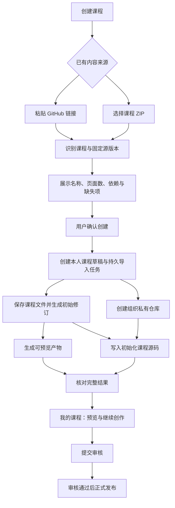

# 通过 GitHub 链接或 ZIP 初始化课程：方案讨论

> 状态：已选定路线 A（标准课程包 + 固定运行依赖），功能尚未实现。核对日期：2026-10-29；代码基线：`ca25ec006ee266193954b90b98c6a899e4daf001`。
> 当前只更新文档，不修改业务功能或部署服务。后续任务、依赖与验收以[路线 A 任务书](课程GitHub链接与ZIP导入创建任务书.md)为准。

## 1. 希望实现什么

在“我要创建课程”中，除现有网页创作、本地 Agent 创作外，支持两种已有课程来源：

- GitHub 课程目录链接，例如：`https://github.com/ReductTech/intuitive-deep-learning/tree/develop/modules/Visual-Generation-Guide`。
- 课程 ZIP，例如本机文件：`D:\WORK_DIR\00shuku\视觉生成html\intuitive-deep-learning-develop\modules\Visual-Generation-Guide.zip`。

用户选择来源后，系统识别课程名称、简介、页面、代码、素材和运行依赖。用户确认后，在“我的课程”生成属于当前用户的独立草稿，并在 `reduct-shuku` 创建一个私有课程仓库，写入初始化内容。完成后能够预览、继续编辑，并走现有审核、发布、共创流程。

这是“复制一个明确版本作为新课程的起点”。不会修改原仓库，不要求 fork 整个平台，也不会把导入过程当作课程审核通过。

浏览器通过文件选择框上传 ZIP。服务器不能通过一个 `D:\...` 路径读取用户电脑；该路径仅是本次核查的输入样本。

## 2. 当前实际能力与缺口

| 环节 | 当前代码 | 本需求需要补充 |
|---|---|---|
| 创建课程 | [CourseHub.tsx](../src/shuku/CourseHub.tsx) 提供网页、本地 Agent；网页模式可导入 PPTX | GitHub/ZIP 来源选择、识别预览、异步进度和恢复入口 |
| PPTX 导入 | [presentations.py](../backend/src/shuku_backend/presentations.py) 解析文字/备注并创建初始修订 | 它不是 React/HTML 课程导入器，不能直接复用 PPTX 解析逻辑 |
| 课程归属 | [storage.py](../backend/src/shuku_backend/storage.py) 的 `create_course()` 设置当前用户为 owner，并限制 creator/admin | 复用创建权限与归属；新增来源、导入状态与幂等记录 |
| 私有建仓 | [github_sync.py](../backend/src/shuku_backend/github_sync.py) 的 `provision_in()` / `provision()` 已有 `github.provision` 任务 | 复用建仓；增加“初始课程文件确实写入并核对成功”的步骤 |
| 私有仓库命名 | 当前为 `course-<course_id>`，带课程身份标记并检查是否误占他人仓库 | 保留该规则；显示名称可以友好，唯一身份不依赖课程标题 |
| 初始修订与构建 | [workflow.py](../backend/src/shuku_backend/workflow.py) 保存不可变修订，排队 `revision.build` | 导入课程转换为现有可编辑工程，接入初始构建 |
| 本地 Agent 工程 | [local_agent_client.py](../backend/src/shuku_backend/local_agent_client.py) 的 `template_project()` 已转换标准模块、生成页面包装入口 | 提取可复用转换能力，避免让后端直接调用带网络/CLI 行为的客户端 |
| 文件存储 | [files.py](../backend/src/shuku_backend/files.py) 的 `Bucket` 已是本地文件桶 | 复用；ZIP、代码、二进制素材、构建产物都留在本地桶 |
| 源码与素材 | [source.py](../backend/src/shuku_backend/source.py) 支持文本与媒体 data URL；最多 500 文件、总编码文本 12 MiB | 样本超过现有限制，需要二进制引用协议，不能只增加上传按钮 |
| 构建适配 | [shuku-source-plugin.mjs](../scripts/shuku-source-plugin.mjs) 已支持共享组件、静态资源和部分 eager glob | 需要识别本样本使用的泛型、`query:'?url'` 图片 glob；目前不能直接处理全部 Vite 语法 |
| 审核与发布 | 已有修订审核、GitHub 同步、正式版本发布 | 保持；新导入课程不能自动进入公共首页 |

这里的“当前代码”是仓库最新代码，不保证服务器已部署了其中所有最新能力。真正实施前需另核对运行版本。

当前业务存储实现是 MySQL/SQLAlchemy；本方案沿用已有数据库。文件仍保存在本地文件桶，不把文件内容改存数据库，也不把本需求扩展成数据库引擎迁移。

## 3. 两个真实输入为什么不能直接复制完事

### 3.1 GitHub 链接是一个仓库子目录

示例可分解为：

```text
owner       ReductTech
repository  intuitive-deep-learning
ref         develop
coursePath  modules/Visual-Generation-Guide
```

在线大纲确实声明了自学入口 `GuidePage.tsx` 和教学入口 `visualGenerationPpt.tsx`，可作为标准模块导入的候选。[示例大纲](https://raw.githubusercontent.com/ReductTech/intuitive-deep-learning/develop/modules/Visual-Generation-Guide/outlines.json)

但该目录不是完整独立项目：部分共享组件位于 `modules/shared`，部分素材可能在仓库根的 `assets/<模块UUID>`，部分功能依赖平台计算接口。导入时必须检查这些依赖，并固定到同一次源提交。

不能把 `develop` 当作永久版本。用户确认导入前应解析成具体 commit SHA，后续读取、重试、构建都使用该 SHA。分支名可能含 `/`，不能通用地把 `/tree/` 后第一段当作分支；解析器需通过 GitHub refs/commit 和目录存在性确认拆分。

### 3.2 已检查本地 ZIP

样本检查结果：

| 项目 | 结果 |
|---|---|
| 压缩包大小 | 11,500,400 字节，约 10.97 MiB |
| 条目数 / 实际文件数 | 155 / 119 |
| 展开文件总大小 | 12,752,362 字节，约 12.16 MiB |
| 外层目录 | `Visual-Generation-Guide/` |
| 大纲与入口 | 包含 `outlines.json`、`GuidePage.tsx`、`visualGenerationPpt.tsx` |
| 共享组件 | 未包含 `shared`；代码存在 `../shared/react` 等外部依赖 |
| 素材 | 模块内部带 `assets/`，包括图片、字体等 |
| 特殊资源语法 | `assets.ts` 使用 `import.meta.glob<string>(..., {eager:true, query:'?url', import:'default'})` |

按当前媒体 data URL 编码方式估算，源码与媒体映射约为 16,134,132 字节，尚未计完整 JSON 结构，已超过现有 12 MiB 限制。

**因此，验收必须使用这个实际 ZIP；仅用一个极小 TSX 压缩包测试通过，不能代表需求完成。**

另外，本地 ZIP 与在线目录不保证是相同版本，不能假定它们的目录布局、素材位置和共享依赖完全相同。

## 4. 已选路线 A 与未选范围

| 路线 | 优点 | 代价与适用范围 |
|---|---|---|
| A：标准课程包 + 固定运行依赖，已选定 | 两种来源共用流程；课程代码可编辑；复用现有审核、构建和私有仓库能力 | 要做模块转换、依赖校验和二进制素材协议 |
| B：将任意完整前端工程上传后运行构建命令 | 支持范围表面上更广 | 需要真正隔离的构建环境、依赖供应链管理和更多资源；不能在现有服务进程直接执行上传的 npm scripts |
| C：只导入构建后的 HTML/dist | 可较快实现静态浏览 | 难以保持源码编辑、页面级共创与版本合并；不能作为本次标准源码课程的替代实现 |

本次已确定采用 A：支持本项目及 `course-template` 的标准 React 模块，保证上述两个样本导入、预览、继续创作完整可用。普通静态 HTML 包可在第二期单独作为一种课程类型，界面明确其能力边界。任意 Next.js/Vue/自定义服务端工程不属于第一期承诺。

## 5. 推荐用户流程



建议将“内容来源”和“后续创作方式”分开：来源可以是空白、PPTX、GitHub、ZIP；后续继续创作仍可选择减论 Agent 或本地 Agent。避免组合出大量互斥按钮。

识别阶段不创建 GitHub 仓库。多课程目录或 ZIP 中存在多个 `outlines.json` 时，应要求选择一个课程；不默认取扫描到的第一个。

用户确认时可修改课程名称、简介、分类。页面展示不需要暴露 framework commit 等内部参数，只在兼容性报告和高级信息中提供。

## 6. 获取、识别与标准化

### 6.1 GitHub 来源

1. 只接受经过验证的 GitHub HTTPS 仓库/目录链接；不接受任意下载域名、服务器本地路径或用户输入的 shell 命令。
2. 固定 owner/repo、repository ID、commit SHA、子目录。第一期优先支持可公开读取的源仓库；私有源需要单独验证读取授权。
3. 通过 Git tree 和 blob 读取课程子树及明确依赖的资源，不默认下载整个大型平台仓库。
4. 如果 tree 响应被截断，按子树逐层读取，不能把不完整文件清单当作成功。[GitHub tree 官方说明](https://docs.github.com/en/rest/git/trees#get-a-tree)
5. 记录源路径、源提交、导入人、导入时间、内容摘要及许可证。读取权限不等于获得重新分发许可。

同一课程导入任务失败重试时，仍读取已固定的 SHA。以后更新原课程应成为一次显式“从源更新”，展示差异、生成新修订，不能后台覆盖用户的后续编辑。

### 6.2 ZIP 来源

1. multipart 流式接收到临时文件，计算 SHA256，不将整个压缩包读入内存。
2. 预检查文件条目，再在受限目录展开；支持无外层目录、一个外层目录、标准 `modules/<课程>` 布局。
3. 拒绝路径穿越、绝对路径、符号链接、大小写冲突、重复路径、加密包和超限压缩内容；不自动执行包内程序。
4. 找到大纲、入口、页面和素材，输出与 GitHub 来源相同的“待导入课程包”。
5. ZIP 中没有可信源提交时，仅记录 ZIP 摘要和用户声明的来源，不猜测 GitHub commit。

首期建议限制：上传不超过 100 MiB，展开不超过 256 MiB，最多 2,000 文件，单文件不超过 32 MiB；均是**拟新增导入入口的建议值**，不是当前已实现的限制。应同时设置账户配额、临时文件过期清理和压缩比保护。

### 6.3 统一课程包与兼容转换

建议新增纯转换模块，接收“文本文件 + 二进制文件 + 来源元数据”，输出：

- 课程名称、简介、分类和页面元数据。
- 自学入口、教学入口、实际页面包装入口。
- 文本源码清单、二进制素材清单及哈希。
- 固定的 authoring/runtime 依赖版本。
- 来源信息、许可证、兼容性报告和转换记录。

优先提取 `local_agent_client.py::template_project()` 的纯转换部分，复用现有标准模块识别、页面包装与自学入口逻辑。不能在服务器导入过程中调用客户端的下载、命令行或 token 读取逻辑。

页面索引要核对实际实现，不能仅把大纲中尚未实现的页面当成可学习页面。动态页面注册无法静态确认时，使用受控构建/隔离浏览器验证，或报告不兼容；不要在持有服务器权限和凭证的 Python/Node 进程中执行上传课程以读取页面列表。

对样本中的图片 glob，建议使用 AST/限定语法转换，展开为来自已校验文件清单的静态资源映射，保留 `courseAssetUrl()` 调用约定。不要用一个泛化正则去改写所有课程代码；不支持的动态 glob 要给出具体文件和原因。

**新课程必须取得新的平台 course ID 和 module ID。** 原模块 UUID、别名和来源关系单独保存。旧 UUID 对应的素材引用可在新课程的独立素材命名空间中保留映射，不能全局替换字符串后误改内容，也不能复用平台原课程的 ownership 或发布记录。

## 7. 框架与素材如何处理

### 7.1 框架固定版本，课程仓库只放课程

当前本地 Agent 已有 [local-authoring.lock.json](../local-authoring.lock.json)，指向固定版本的 `reduct-shuku/course-template`。可以建立标准导入的 runtime profile，复用其共享组件，而不是给每门课程上传整个平台。

但是，“同为 shared/react”不代表所有版本兼容。GitHub 源课程原有 shared 版本和 ZIP 缺失的 shared 都要校验；ZIP 可由识别结果推荐 runtime profile，并在创建前验证，不能永远盲用最新版。

目标私有仓库不包含平台登录、数据库、审核后端、全量框架、`node_modules` 或凭证。框架版本记入锁文件，本地预览工具按锁文件准备外围工程。

### 7.2 二进制素材走本地文件桶

建议保留现有文本源码协议，同时引入独立的二进制素材清单，避免将大图片反复 Base64 塞进 `project.json`。

概念性结构如下，字段名和版本号均待实现时确定：

```json
{
  "formatVersion": 2,
  "source": {
    "files": {
      "modules/Visual-Generation-Guide/GuidePage.tsx": "...课程文本源码..."
    }
  },
  "sourceAssets": {
    "modules/Visual-Generation-Guide/assets/images/example.png": {
      "sha256": "<sha256>",
      "size": 12345,
      "mime": "image/png"
    }
  },
  "authoringModule": "modules/Visual-Generation-Guide",
  "sourceGuideEntry": "modules/Visual-Generation-Guide/GuidePage.tsx",
  "authoringVersion": "<固定且已校验的框架提交>"
}
```

`sourceAssets` 不是现有接口已经接受的字段，也不能仅凭客户端提交一个哈希就允许引用文件：必须核对该素材属于当前账号、课程或已授权导入会话。

需要同时打通接收、修订保存、构建解析、网页编辑保存、本地 Agent pull/push、GitHub 导出和删除回收。只改 ZIP 上传上限，而编辑保存仍把素材转回 12 MiB JSON，需求仍不完整。

旧 data URL 格式保留兼容，新格式不要求批量重写历史课程。源码文本限制和二进制配额分别校验。构建器只能按课程清单读取已授权对象，不允许猜测服务器路径或引用其他用户的文件桶。

## 8. reduct-shuku 私有仓库的初始化

本次通过公开 GitHub API 核对，`reduct-shuku` 的账号类型为 Organization，与现有 `/orgs/{owner}/repos` 路径匹配。

已有建仓能力应继续复用，但必须区分三个完成条件：

1. 仓库存在且 `private=true`。
2. 仓库绑定正确的课程和组织身份，平台凭证确实能访问新仓库。
3. 初始化课程文件已经写入，并读回核对 commit/tree 和文件摘要。

只有一个自动生成的 README，并不能算“课程已初始化到 GitHub”。

GitHub 官方建组织仓库接口支持私有创建；实际部署还需验证 GitHub App 的建仓权限、Contents 写权限和新仓库的安装授权范围。不能仅凭安装了 App 就认定全部具备。[官方建仓接口与权限](https://docs.github.com/en/rest/repos/repos#create-an-organization-repository)

建议默认：

- 沿用 `course-<course_id>`，创建为私有，不修改源仓库。
- 如果同名仓库已存在，仅在 repository ID、课程标记及归属都确认后复用；不能接管别人的同名仓库。
- 对“远端已创建，但响应丢失/本地未绑定”的情况，先查询并核对远端事实，再继续绑定，不重复创建。
- 初始源码提交直接进入这个尚未公开的新仓库的默认分支；这不是审核通过或正式发布，不为初始化制造一个无人处理的审核 PR。
- 以固定路径清单创建 blobs/tree/commit，最后更新目标 ref；请求超时后读取 ref/commit 对账，不立即再提交一遍。[Git tree、提交与 ref 的关系](https://docs.github.com/en/rest/git/trees#create-a-tree)

推荐仓库布局保留现有 `courses/` 导出约定，并明确增加格式版本：

```text
course.manifest.json              # 包格式、课程身份、入口、框架锁定与文件映射
source-origin.json                # 只含来源和内容摘要，不含 token 或本机私有路径
README.md
LICENSE / NOTICE                  # 保留必要的许可与署名
courses/
  project.json                    # 兼容课程数据结构
  sources/modules/<课程目录>/...  # 实际可编辑课程源码
  assets/...                      # 原始二进制素材，不是 Base64 文本文件
```

最终路径需要与现有 `GitHubSync.export()`、本地 Agent 和课程包导入器统一定义，不能各自使用一套目录。导入前后的格式可以不同，但必须有明确版本和双向映射，能够从目标私有仓库重新导入出相同课程。

私有仓库归组织管理，课程作者归当前术库账号；作者无需绑定个人 GitHub 就能通过平台继续编辑。如需本人直接 clone 私有仓库，则另行授予 GitHub 协作者/团队权限，不能把组织 App 凭证交给浏览器或本地 Agent。

**“初始化时私有”与“以后发布时是否公开仓库”要分开。** 当前 `github_sync.py` 的正式发布流程包含修改仓库可见性的逻辑。本需求默认仅保证初始化私有；是否要求发布后仍永久私有，是需要单独明确的产品规则。导入完成绝不自动调用发布流程。

## 9. 数据、接口与任务设计

### 9.1 数据建议

复用 `shuku_courses`、`shuku_revisions`、`shuku_tasks`、`shuku_github_repositories`、`shuku_audit`。课程的 `draft/published/hidden` 业务状态不增加一堆导入中间状态。

拟新增：

| 数据 | 内容 |
|---|---|
| `shuku_course_imports` | 导入人、请求幂等键、来源类型、固定源提交/ZIP 摘要、阶段、错误码、关联课程/修订/子任务、框架版本、远端初始化提交、过期时间 |
| `shuku_course_import_files` 或等价清单 | 导入会话范围内的路径、SHA256、大小、MIME、文本/媒体分类，用于授权和回收 |
| 来源与转换记录 | 原模块身份、来源路径、许可证、标准化前后摘要、兼容性报告；可用 import 记录的 JSON 字段或独立结构保存 |

数据库只存业务关系和对象元数据；ZIP 原件、媒体、源码正文与构建产物放本地文件桶。未确认的分析会话应有过期时间，不能无限堆积。

### 9.2 拟新增接口

以下均是设计建议，不是已有可调用 API：

| 接口 | 用途 |
|---|---|
| `POST /api/shuku/course-imports/github` | 提交链接，建立异步识别会话；返回 202 和 import ID |
| `POST /api/shuku/course-imports/zip` | multipart 上传 ZIP，建立识别会话；返回 202 和 import ID |
| `GET /api/shuku/course-imports/{id}` | 仅当前导入人/授权管理员读取来源、识别报告、阶段及子任务结果 |
| `POST /api/shuku/course-imports/{id}/confirm` | 提交确认信息和请求幂等键，创建一个本人草稿；重复确认返回同一个课程 |
| `POST /api/shuku/course-imports/{id}/retry` | 从失败阶段恢复，不改变固定来源 |
| `POST /api/shuku/course-imports/{id}/cancel` | 取消；已创建课程时转入现有删除/补偿流程 |

源码/素材后续变更还需扩展现有编辑、Agent 协议中的媒体上传与引用；不必把所有交互都塞入一个新的大 JSON 接口。

### 9.3 任务与状态

建议阶段：`received → inspecting → needs_confirmation → normalizing → revision_saved → building / repository_provisioning → repository_initializing → ready`。并行环节应分别保留 build status、repository status，不能用一个“处理中”掩盖具体失败。

`ready` 表示初始修订可预览、私有仓库已绑定、初始化源码提交已核实；不代表审核通过。GitHub 暂时失败但本地预览成功时，可以允许继续编辑，但界面必须说明“私有仓库初始化未完成”，不能宣称任务全部成功。

复用 [workers.py](../backend/src/shuku_backend/workers.py)、任务租约和 [build_process.py](../backend/src/shuku_backend/build_process.py) 的进程组回收。拟增加 `course.import.inspect`、`course.import.normalize`、`course.import.finalize` 和必要的 `github.initialize` 处理器，具体可合并为少量具有检查点的任务。

**不能在现有单个 worker handler 中阻塞等待自己排入的 `revision.build` 或 `github.provision`。** 应保存依赖后退出/延期，释放任务与课程锁，等子任务完成再推进；否则可能自己等待自己或长期占用课程资源。

下载、GitHub API 和构建均在数据库事务之外执行，采用短事务写检查点。构建沿用有超时和心跳的受控流程；首期构建并发建议为 1，网络任务和大 ZIP 不与服务请求争抢大量内存。

## 10. 失败恢复与删除

| 情况 | 处理原则 |
|---|---|
| 包缺入口、共享依赖不兼容 | 在确认前给出缺失文件/依赖报告，不创建空课程和空仓库 |
| 链接分支更新了 | 继续使用原 SHA；用户显式选择重新识别才采用新版本 |
| ZIP 上传中断 | 保留完整上传才进入识别；清理不完整临时文件 |
| 用户双击确认 / 网络重试 | 唯一请求键绑定导入人和导入记录，返回同一 course ID |
| GitHub 建仓成功但响应丢失 | 按课程标记和 repository ID 查询对账，恢复绑定 |
| 远端提交成功但响应丢失 | 核对目标 ref 与内容摘要，避免重复初始化提交 |
| 构建失败但仓库已建 | 保留私有草稿和可定位的失败原因；只重试失败步骤 |
| 用户在导入期间又编辑了课程 | 以 expected revision/CAS 防覆盖；旧导入不能改写新 head |
| 服务重启或租约丢失 | 从持久检查点恢复；旧执行者不能再写最终状态或覆盖 ref |
| 删除与建仓并发 | 删除流程需对账可能已创建但未绑定的远端仓库，复用现有恢复能力 |
| 用户取消且已产生远端资源 | 进入受审计的补偿/删除任务；只处理属于本导入的资源，不直接抹掉用户后续成果 |

删除课程时需纳入 import 对象、ZIP 原件和素材引用的清理。共享哈希对象只有在所有课程/修订/有效导入会话都不再引用后才能回收；已有 PR、贡献和审核历史按既定保留政策处理。

## 11. 必要的安全与权限边界

- 上传/确认前检查账号角色、会话、CSRF 和配额；状态、文件、重试均核对 owner，防止枚举 import ID 读取他人课程。
- URL 只解析为受控 GitHub API 请求；仓库下载重定向如涉及 codeload，单独校验域名，不能向重定向目标转发原 Authorization。
- ZIP 中的 `package.json` 只用于依赖分析，不执行 `npm install`、lifecycle scripts、上传的 build.sh 或服务端代码。标准构建使用平台固定依赖和受控入口。
- 不将 `.env`、私钥、token、`.git`、`node_modules`、缓存或其他课程目录同步到目标仓库。许可证文件应保留。
- 构建在受限工作目录和独立进程/容器边界内完成，不带业务数据库与组织凭证；保留超时、资源限制及进程组清理。
- 私有课程继续使用授权预览及沙箱策略。不要为了让新导入课程能联网，就给 iframe 开放 `allow-same-origin` 或业务 Cookie；课程确需计算 API 时使用经过授权的平台代理能力。
- 如果旧课程依赖任意远程 CDN、外站 iframe 或平台外接口，应明确报为兼容性问题并给出适配项，不能承诺导入后全部自动可用。

## 12. 具体改哪些代码

现有文件链接可直接定位；“拟新增”文件尚不存在。

| 文件 | 修改内容 |
|---|---|
| [src/shuku/CourseHub.tsx](../src/shuku/CourseHub.tsx) | 创建页接入来源选择、上传/粘贴、确认和导入进度；保留原创作方式 |
| 拟新增 `src/shuku/CourseImport.tsx` | 独立承载来源、识别报告、阶段、重试和恢复 UI，避免继续膨胀 CourseHub |
| [src/shuku/client.ts](../src/shuku/client.ts) | 导入会话类型、202 响应、multipart 及错误码支持 |
| [backend/src/shuku_backend/api.py](../backend/src/shuku_backend/api.py) | 新增导入端点、流式上传与权限校验；不要在 HTTP handler 同步 clone/build |
| 拟新增 `backend/src/shuku_backend/course_imports.py` | 导入会话、确认创建、阶段推进、幂等、重试与取消编排 |
| 拟新增 `backend/src/shuku_backend/course_package.py` | 两种来源共用的安全路径、大纲识别、依赖报告、标准化与包格式定义 |
| 拟新增 `backend/src/shuku_backend/github_course_source.py` | 源链接解析、固定 commit、tree/blob 获取与来源记录；与目标仓库写入凭证职责分离 |
| [backend/src/shuku_backend/local_agent_client.py](../backend/src/shuku_backend/local_agent_client.py) | 将标准模块转换提取为可复用纯逻辑；Agent 与导入器使用同一契约 |
| [backend/src/shuku_backend/local_agent.py](../backend/src/shuku_backend/local_agent.py) | 素材引用协议与 scoped 凭证权限，兼容导入后的继续创作 |
| [backend/src/shuku_backend/source.py](../backend/src/shuku_backend/source.py) | 保持旧格式兼容；新增二进制清单校验、文本/媒体独立限制 |
| [backend/src/shuku_backend/workflow.py](../backend/src/shuku_backend/workflow.py) | 二进制素材纳入修订文件清单、授权、构建输入及不可变 hash |
| [scripts/shuku-source-plugin.mjs](../scripts/shuku-source-plugin.mjs) | 素材解析与限定 glob 适配；禁止目录逃逸和任意宿主文件回退 |
| [scripts/build-shuku-preview.mjs](../scripts/build-shuku-preview.mjs) | 标准模块双入口、受控素材清单、框架锁与预览构建接入 |
| [backend/src/shuku_backend/github_sync.py](../backend/src/shuku_backend/github_sync.py) | 复用 private provision，新增幂等初始提交与二进制导出、远端核对 |
| [backend/src/shuku_backend/adapters/github.py](../backend/src/shuku_backend/adapters/github.py) | 如需补充 tree/blob/ref 调用，保持受控 API 域名、超时与凭证隔离 |
| [backend/src/shuku_backend/application.py](../backend/src/shuku_backend/application.py) | 注册导入与初始化任务处理器 |
| [backend/src/shuku_backend/schema.py](../backend/src/shuku_backend/schema.py)、[migrations.py](../backend/src/shuku_backend/migrations.py) | 新增导入记录、唯一约束和显式升级迁移；不可改写已应用迁移摘要 |
| [backend/src/shuku_backend/governance.py](../backend/src/shuku_backend/governance.py)、[github_sync.py](../backend/src/shuku_backend/github_sync.py) | 删除/取消时覆盖导入对象、可能已创建的私有仓库与失败补偿 |
| [backend/src/shuku_backend/drafts.py](../backend/src/shuku_backend/drafts.py)、[src/creator/model.ts](../src/creator/model.ts) | 保留新素材清单，网页再次编辑保存不会丢素材或退回巨大 Base64 JSON |
| [deploy/5173/nginx.conf](../deploy/5173/nginx.conf) | 实施时仅核对 Demo 上传上限、超时及素材鉴权；产品部署配置分别维护 |

不建议通过修改 [library_catalog.py](../backend/src/shuku_backend/library_catalog.py) 或把用户代码写进平台 `modules/` 来实现。前者负责平台固定课程目录，后者会让用户上传课程依赖整个平台重新部署，并混淆用户归属与公共课程。

[organization_catalog.py](../backend/src/shuku_backend/organization_catalog.py) 是组织公开课程待收录流程，也不能替代用户自己的私有初始化流程。新私有草稿不应被公开仓库扫描器误收录。

## 13. 实施拆分与验收

### 第一批：统一包格式与两个样本的兼容性

- 提取标准模块转换，建立文本/二进制分离清单。
- 用 GitHub 子目录固定提交和本地真实 ZIP 完成识别与依赖报告。
- 缺 shared、图片 glob、素材别名等问题可解释、可验证；尚不创建用户课程或远端仓库。

### 第二批：用户课程与可恢复导入

- 确认后原子创建本人草稿、初始修订、任务和来源记录。
- 接入可预览产物；网页和本地 Agent 都能继续修改并保存素材。
- 无需重新部署平台前端即可预览新导入的课程。

### 第三批：私有仓库初始化与完整闭环

- 复用 private 建仓，写入真实源码与原始媒体，核对远端提交。
- 目标仓库可重新导入出同一课程；失败、取消、删除不会留下无法定位的资源。
- 新课程仍走首次审核和发布，未经审核不进入公共首页。

上述三批合起来才满足本需求，不能把“只识别到了 ZIP”或“只创建了空私有仓库”当作完成。

### 精准测试建议

1. **来源解析**：示例子目录、带斜杠的 ref、固定 SHA，以及越权/非 GitHub URL 拒绝。
2. **包兼容**：外层目录、多个候选课程、缺共享依赖、样本图片 glob、目录逃逸与重复路径。
3. **大素材回路**：真实 ZIP 的全部素材可显示；再次编辑保存及 Agent pull/push 后没有丢失，不受旧 12 MiB 编码瓶颈影响。
4. **课程归属与可见性**：重复确认只产生一个本人草稿；其他用户不可读；公共首页不出现未发布导入课程；原课程不变。
5. **GitHub 初始化**：private=true、身份一致、原始文件确实入库；建仓/提交响应丢失后对账不重复；不夹带平台框架或凭证。
6. **构建与恢复**：超时/失去租约能回收进程，状态有终态；父任务不阻塞子任务；重启继续同一来源，不覆盖新修订。
7. **删除补偿**：初始化途中删除、未绑定远端仓库、共享对象仍被其他修订引用等关键情况。
8. **端到端**：上述 GitHub 链接和本地 ZIP 各完成一次“导入→私有仓库→双模式预览→编辑保存→提交审核”；GitHub 仓库状态和平台状态都要核对。

实现时扩展 [test_github.py](../backend/tests/shuku_backend/test_github.py)、[test_source.py](../backend/tests/shuku_backend/test_source.py)、[test_local_agent_template.py](../backend/tests/shuku_backend/test_local_agent_template.py)，并新增导入服务与页面测试。正常测试用小型完整夹具；真实 ZIP 可作为人工/集成验收输入，不把 11 MB 二进制样本直接提交进平台测试目录。

## 14. 建议默认与待确认事项

本讨论稿建议按以下默认推进，后续实现前应将有变化的选项更新到正式验收要求：

| 问题 | 建议默认 |
|---|---|
| 导入与原课关系 | 独立复制，保留来源；更新原课必须显式操作 |
| 初始归属 | 当前术库 creator/admin 用户，不因源仓库作者而改写 owner |
| GitHub 目标 | `reduct-shuku/course-<course_id>`，初始化私有 |
| 框架进不进课程库 | 不上传全量框架，记录固定运行依赖并校验兼容性 |
| 初始包类型 | 标准 React 课程模块；HTML/dist 与任意前端项目另设能力边界 |
| 源读取范围 | 首期公开 GitHub 来源；私有源读取授权后续扩展 |
| 创建完成标准 | 课程可预览 + 私有仓库已初始化核实，不自动发布 |
| 正式发布后仓库可见性 | 需要单独明确；当前代码可能转公开，不能混同于初始化私有 |
| GitHub 故障 | 保留可恢复私有草稿，明确未全部完成；不重复创建 |
| 文件保存 | 本地文件桶，业务关系与摘要进现有数据库 |

建议先把两个真实输入作为第一期的固定验收场景，打通统一导入、素材、共享依赖和私有初始化闭环，再扩大到其他课程工程类型。
